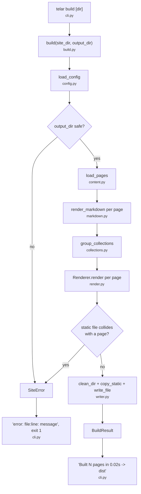
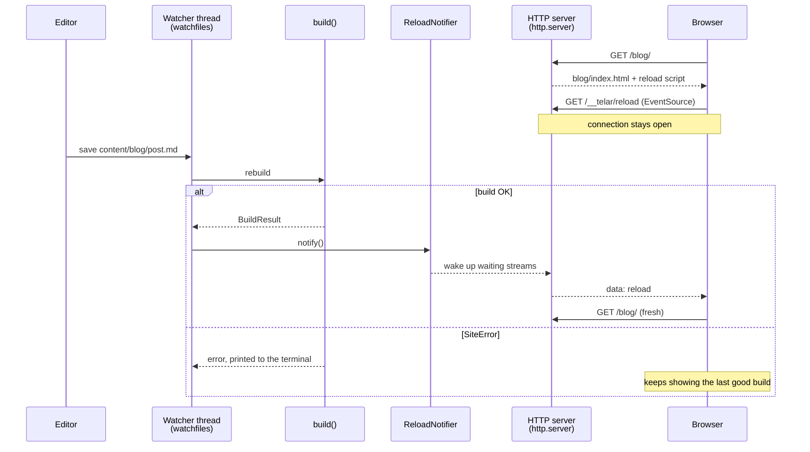

# Architecture

Telar is a pipeline: read the config, load the Markdown, render it, write the files. Each step
lives in its own small module, and the whole build is one function, `telar.build.build()`,
which you can call without going through the CLI. That's what most tests do.

## Modules

All modules live in `src/telar/`.

| Module           | Responsibility                                                                 |
| ---------------- | ------------------------------------------------------------------------------ |
| `cli.py`         | Typer commands (`init`, `build`, `dev`). Turns arguments into calls and `SiteError`s into a red message and exit code 1. No logic of its own. |
| `config.py`      | Reads `site.toml` with `tomllib` and validates it into a `SiteConfig` (Pydantic). |
| `content.py`     | Finds the `.md` files, parses and validates the front matter, works out each page's URL and output path, skips drafts. Produces `Page` objects. |
| `markdown.py`    | Markdown → HTML with markdown-it-py. One function.                             |
| `collections.py` | Groups pages by top-level folder and sorts them newest first.                  |
| `render.py`      | `Renderer`: sets up Jinja2 and renders a `Page` with its layout. Turns template errors into `SiteError`s with the template's file and line. |
| `writer.py`      | Filesystem helpers: wipe a folder, write a file, copy `static/`, list files.   |
| `build.py`       | Orchestrates the steps above. Also guards against dangerous `output_dir` values. |
| `devserver.py`   | `DevServer`: HTTP server + file watcher + live reload over Server-Sent Events. |
| `scaffold.py`    | Copies the starter site (`starter/`) for `telar init`.                         |
| `errors.py`      | `SiteError`, the one exception type for problems the user can fix.            |

Dependencies only go downwards: `cli` → `build`/`devserver`/`scaffold` → the rest. `content`,
`markdown`, `collections` and `writer` don't know about each other, and none of them know about
the CLI.

## A build, step by step

This is everything that happens between typing `telar build` and having files in `dist/`.

1. **CLI** (`cli.build`). Typer parses `[dir]` and `--out`, then calls `build()`. It catches
   `SiteError` and prints `error: <file>:<line>: <message>` in red.
2. **Paths** (`build.build`). `site_dir` is resolved to an absolute path. The content,
   templates, static and output folders are computed relative to it.
3. **Config** (`config.load_config`). `site.toml` is parsed with `tomllib` and validated by
   `SiteConfig`. Unknown keys are rejected, and `base_url` loses its trailing slash.
4. **Output guard** (`build._check_output_dir`). `dist/` is deleted on every build, so `build()`
   refuses an `output_dir` that is the site folder, one of its parents, or overlaps
   `content/`, `templates/` or `static/`.
5. **Content** (`content.load_pages`). Every `*.md` under `content/` (skipping hidden folders) is
   read as UTF-8. For each file:
   - python-frontmatter splits the YAML from the body. YAML errors become a `SiteError` with
     the file and line.
   - `FrontMatter` (Pydantic) validates `title`, `date`, `draft`, `tags` and `layout`. Any other
     key goes to `page.extra`.
   - `route_for` turns the path into a URL and an output file (`blog/hola.md` → `/blog/hola/`,
     `blog/hola/index.html`).
   - Drafts are dropped, and two pages with the same URL are an error.
6. **Markdown** (`markdown.render_markdown`). Each page's body becomes HTML and is stored in
   `page.content`, wrapped in `Markup` so Jinja won't escape it again.
7. **Collections** (`collections.group_collections`). Pages are grouped by top-level folder and
   sorted newest first. A `_index.md` creates its collection even if it's empty.
8. **Rendering** (`render.Renderer`). Jinja2 is set up with autoescaping and `StrictUndefined`.
   Each page is rendered with `templates/layouts/<layout>.html` and gets `page`, `site` and
   `collections`. The result is kept **in memory**, in a `{output_path: html}` dict.
9. **Collision check** (`build._check_static_collisions`). A file in `static/` can't have the
   same output path as a generated page.
10. **Writing** (`writer`). Only now is the disk touched: `dist/` is wiped, `static/` is copied
    into it, and every rendered page is written, creating folders as needed.
11. **Result**. `build()` returns `BuildResult(output_dir, page_count)` and the CLI prints a
    one-line summary.

Since steps 3–9 don't write anything, **a failed build leaves the previous `dist/` intact**. The
dev server relies on this to keep serving the last good version.

## The dev server

`telar dev` builds the site once, then runs two things side by side:

- **HTTP** (`DevRequestHandler`): a `SimpleHTTPRequestHandler` from the standard library that
  serves the output folder, with three tweaks:
  - HTML pages get a one-line `<script>` with an `EventSource`, inserted before `</body>`. It's
    added when the page is served, so `dist/` stays clean.
  - `Cache-Control: no-store` on every response.
  - `/__telar/reload` keeps the connection open as a Server-Sent Events stream.
- **Live reload** (`ReloadNotifier`): a counter guarded by a `threading.Condition`. Each open
  event stream waits on it, and `notify()` wakes them all up so each one sends `data: reload`.
  Every 15 seconds the stream sends a comment line (`: ping`), which is how closed tabs are
  noticed and their threads freed.
- **Watcher** (`DevServer._watch`): `watchfiles.watch()` on the site folder, with `--poll`
  mapped to `force_polling`. The output folder is ignored, and so are events on folders
  themselves: recreating `dist/` bumps the site folder's mtime, and with polling that used to
  trigger an endless rebuild loop.

See [ADR 0005](decisions/0005-dev-server.md) for why it's built this way.

## Errors

Anything the user can fix is raised as `SiteError(message, path, line)`, and the CLI is the
only place that catches it. The line comes from:

- **TOML:** `tomllib` puts it in the message (`at line 2, column 5`).
- **YAML front matter:** the parser's `problem_mark`, plus one for the opening `---`.
- **Front matter fields:** the first line in the file that starts with `<field>:`.
- **Templates:** `TemplateSyntaxError` carries it. For runtime errors (undefined variables...)
  Jinja rewrites the traceback so template frames point at the `.html` file, and `Renderer`
  picks the last frame inside `templates/`.

Anything else is a bug in Telar and gets a normal traceback.

## Tests

`tests/` mirrors the modules (`test_content.py`, `test_render.py`, ...). Most tests build tiny
sites in `tmp_path`. `conftest.py` provides a `site` fixture with a complete small site.
`test_integration.py` builds `examples/basic` into a temp folder and checks the output, and
`test_scaffold.py` makes sure `examples/basic` matches the starter site.
